# Archive Manager | مدیریت فایل‌های فشرده

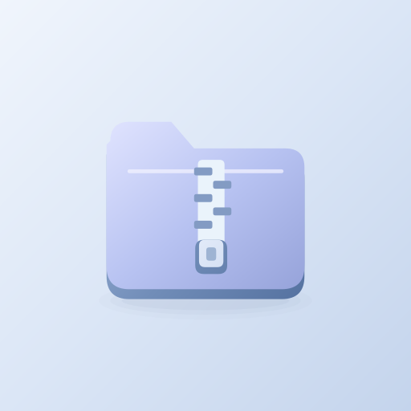

[دریافت آخرین نسخه / Download latest](https://github.com/cinaasadpour-hash/archive-manager/releases/latest)

## فارسی

مدیریت فایل‌های فشرده ابزارهایی برای کار با آرشیوها و فایل‌های گوشی در اختیار شما می‌گذارد. فایل‌های فشرده را پیدا کنید، محتوای آن‌ها را ببینید و فایل‌های مورد نیاز را در مسیر دلخواه استخراج کنید.

برای جمع‌کردن و اشتراک‌گذاری فایل‌ها، آرشیو جدید بسازید و با قالب‌های پشتیبانی‌شده مانند ZIP، 7Z و خانوادهٔ TAR کار کنید. امکانات مدیریت فایل و کنترل عملیات، انجام کارهای روزمره با آرشیوها را ساده‌تر می‌کنند.

دسترسی به پوشه‌ها تابع مجوزهای ذخیره‌سازی و محدودیت‌های اندروید است. امکانات ساخت و استخراج برای همهٔ قالب‌ها یکسان نیستند و RAR5 در نسخهٔ فعلی پشتیبانی نمی‌شود.

این برنامه دارای تبلیغات است.

### شروع کار

دسترسی مدیریت فایل‌ها را در تنظیمات اندروید فعال کنید. فایل‌ها را مرور کنید، آرشیو را باز کنید و استخراج یا فشرده‌سازی را انجام دهید. پوشه‌های محافظت‌شده اندروید همچنان محدودند.

### تبلیغات

بنر همسان در اخیر و تنظیمات، خارج از عملیات فایل. نبود تبلیغ مانع استفاده از برنامه نمی‌شود.

## English

Archive Manager provides tools for working with compressed files and organizing files on your phone. Find archives, browse their contents and extract the files you need to a chosen location.

Create archives to collect and share files, and work with supported formats such as ZIP, 7Z and the TAR family. File management tools and operation controls simplify everyday archive tasks.

Folder access depends on storage permissions and Android restrictions. Creation and extraction capabilities vary by format. RAR5 is not supported in the current version.

This app contains advertising.

### Getting started

Enable file management access in Android settings, browse files, then open an archive or create a new one. Protected Android folders remain restricted.

### Advertising

Native banner in Recents and Settings, outside file operations. An unavailable ad does not block ordinary use.

## Download and updates | دریافت و به‌روزرسانی

Android APK, version **1.0.3**. Package: `com.sinatools.archiver`.
For updates, install over the existing app to preserve its local data. Do not uninstall first.

برای حفظ اطلاعات، نسخه جدید را روی نسخه قبلی نصب کنید؛ ابتدا برنامه را حذف نکنید.

[Privacy / حریم خصوصی](PRIVACY.md)

This repository distributes the signed app and user guide. Private signing keys and local build credentials are not published.

<!-- STORE-GALLERY -->

## Screenshots | تصاویر برنامه

App screens in English and Persian; sample content is used where needed.

### English

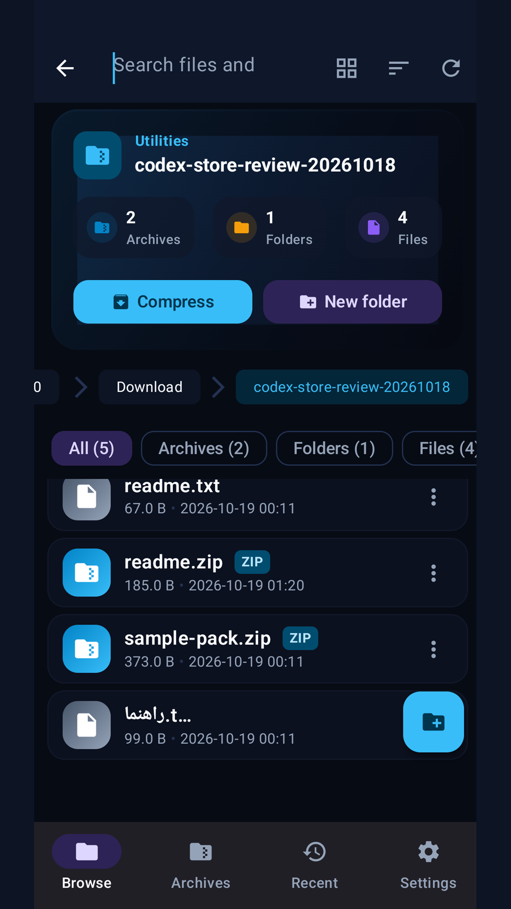
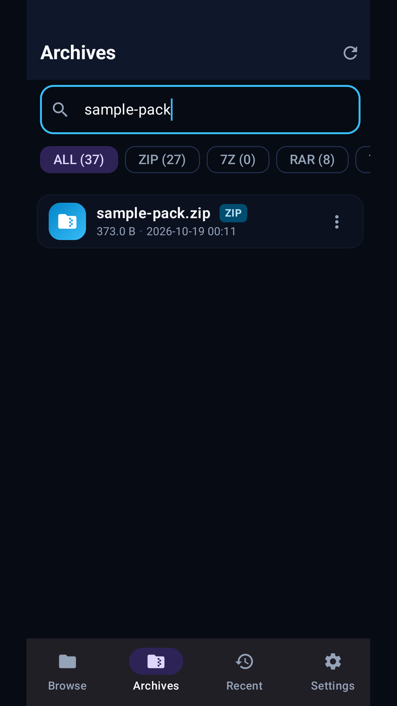
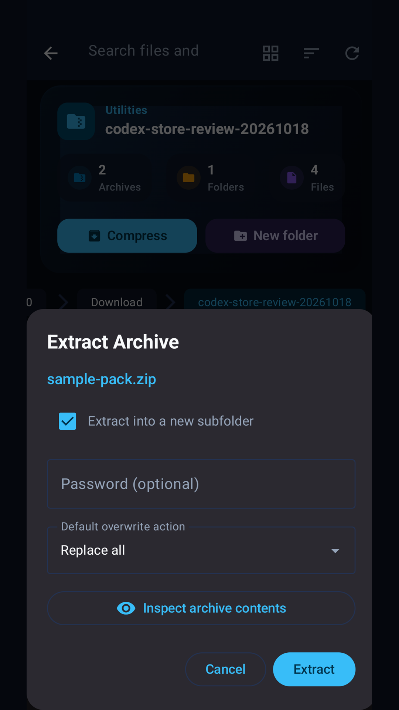
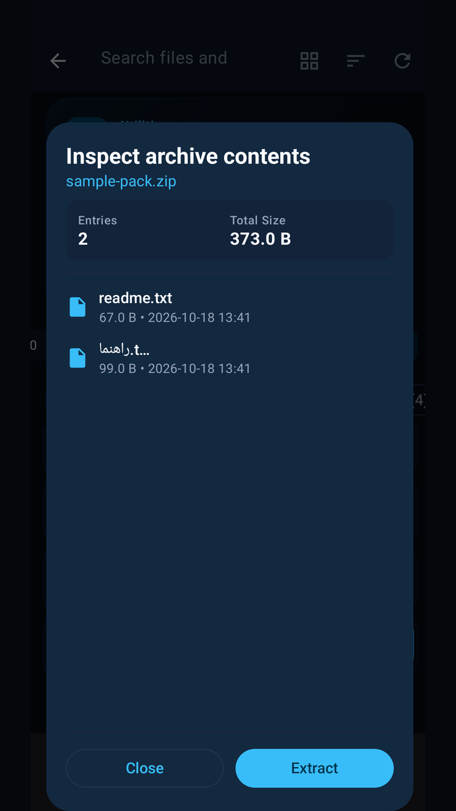
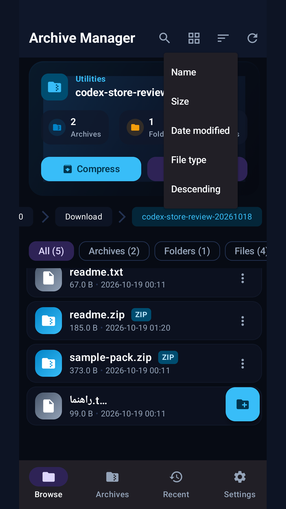

### فارسی

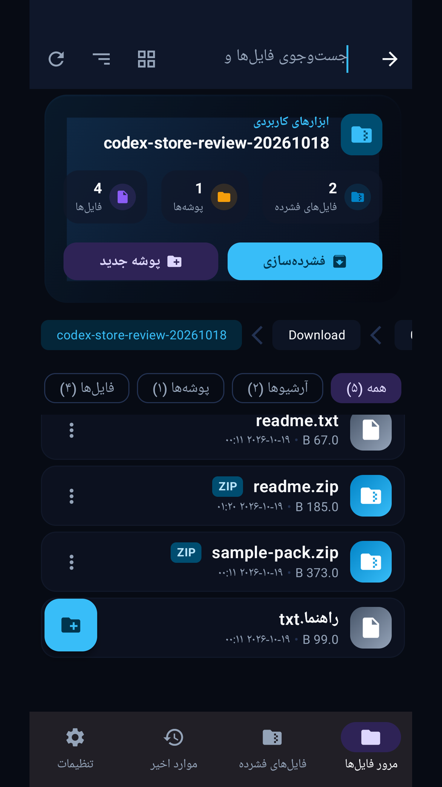
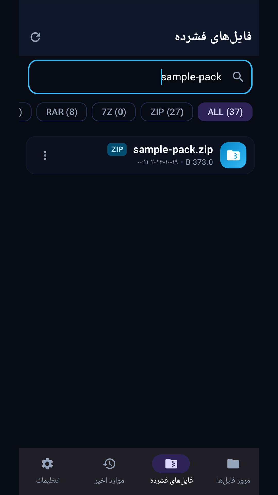
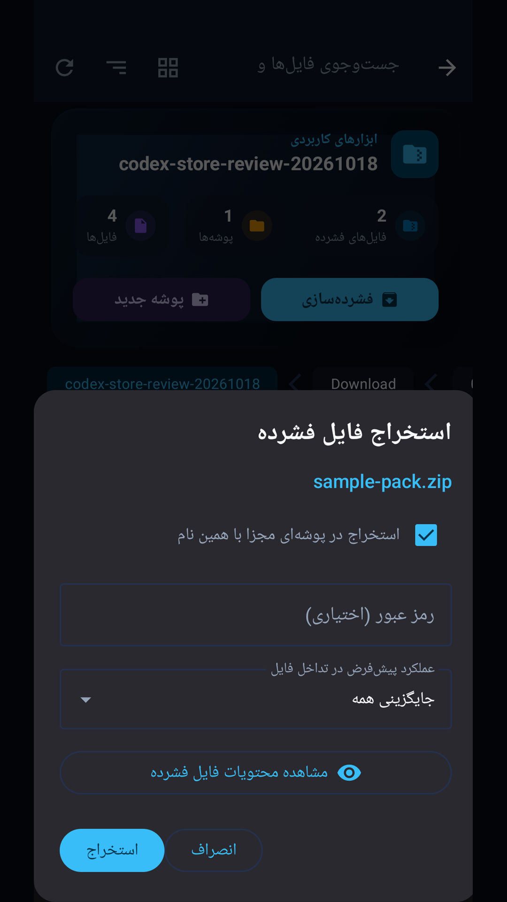
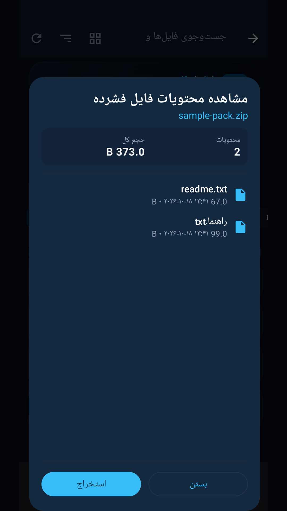
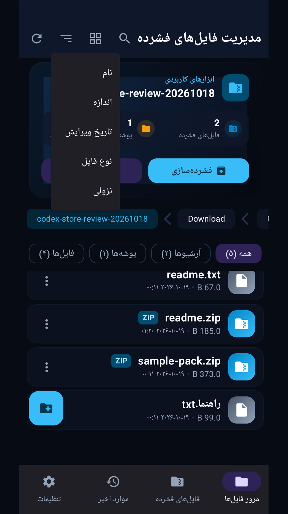

